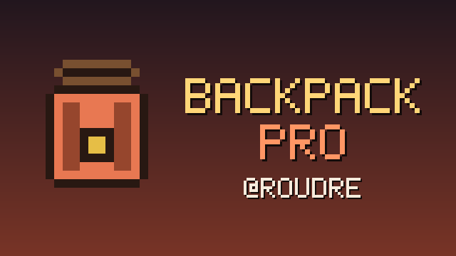

# 🎒 Backpack Pro

Mochilas para **Minecraft Bedrock** con un almacenamiento nuevo que **guarda tus cosas al instante y no las pierde**. Inspirado en *Sophisticated Backpacks* (Java Edition), de **@P3pp3rF1y**.

**[⬇️ Descargar Backpack Pro.mcaddon](Backpack%20Pro.mcaddon)** · Minecraft Bedrock 1.26+ · PC, celular y consola



## Qué tiene
- **6 mochilas**: cuero, cobre, hierro, oro, diamante y netherite, cada una con más espacio. Se mejoran sin perder lo que llevan.
- **Pantalla de cofre real**: se arrastran y sueltan los objetos, como en un cofre de Minecraft.
- **Mejoras que se instalan en la mochila**, cada una con su pestaña: horno portátil, mesa de trabajo, tanque de agua y lava, comida automática, cultivo portátil, imán de objetos, tocadiscos, minería rápida, más fuerza, corazones extra, respiración acuática, antorcha dinámica y transferencia automática.
- **Skins y tintes** para cambiar el aspecto de la mochila.
- **8 discos de música** que suenan desde la mochila.
- **Se ve en la espalda** del jugador, con un modelo 3D.
- **Todo en español.**

## El problema que resuelve
Los add-ons de mochilas para Bedrock suelen **perder objetos**. Este también los perdía, por cuatro razones:
1. Cada 8 minutos una "optimización" **cerraba las mochilas aunque estuvieran abiertas**.
2. Si una mochila no tenía ID, **la borraba sin guardar**.
3. El guardado iba **en cola**: si el mundo se cerraba antes, se perdía lo último.
4. Si la zona de guardado no había cargado, **leía la mochila vacía y la guardaba encima** de lo que tenía.

## Cómo lo resolví
- **Almacenamiento nuevo** ([`Database.js`](Database.js)) con la **misma forma de uso** que el anterior, así que el resto del add-on no cambia:
  - Cada mochila tiene su **almacén permanente** en una zona del mundo que siempre está cargada.
  - Guarda **al instante**, sin cola.
  - Si la zona aún no carga, **no inventa una mochila vacía**, y lo nuevo **se suma** a lo que ya había en vez de reemplazarlo.
  - **Pasa solas las mochilas guardadas con el sistema anterior**, sin borrar el respaldo.
- **Parches exactos** al script, que venía ofuscado: no se cierran mochilas abiertas, nada se borra sin guardar y se corrige `lockMode` para las versiones nuevas.
- **Jugador actualizado a la 1.26**, para que no salgan errores de animación, y la **X para cerrar** arreglada.
- **Pruebas automáticas** del almacenamiento con un Minecraft simulado ([`pruebas/`](pruebas)).

Todo se aplica con un script que se puede volver a correr ([`parchar.py`](parchar.py)). Cada parche comprueba que su texto exista **exactamente una vez** antes de cambiarlo.

```bash
python parchar.py          # genera "Backpack Pro.mcaddon"
cd pruebas && node prueba.mjs
```

## Instalar
1. Descarga **`Backpack Pro.mcaddon`** y ábrelo con Minecraft.
2. En tu mundo, activa **Backpack Pro** en *Packs de comportamiento*. Las texturas se activan solas.

## Créditos
- **@Roudre**: almacenamiento sin pérdidas, arreglos, traducción y portada.
- Inspirado en **Sophisticated Backpacks** (Java Edition), de **@P3pp3rF1y**.
- Música libre (CC0, [OpenGameArt](https://opengameart.org)): *Snowfall* y *Nevada (bucle)* de Kistol, *Desert Theme* de yd, *Breves Dies Hominis* de Magdalen Kadel, *Boss Battle Theme* de CleytonKauffman, *Night Prowler* de section31, *Prepare Your Swords* de bojidar-bg y *Cave Theme* de Brandon75689.
